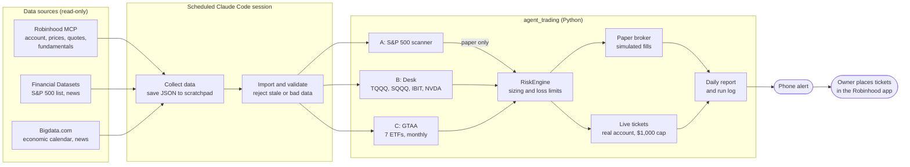
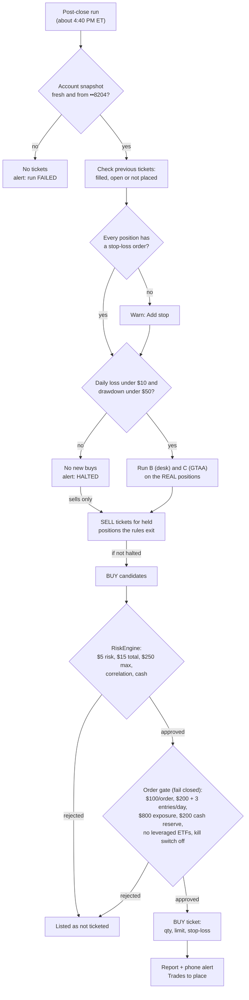
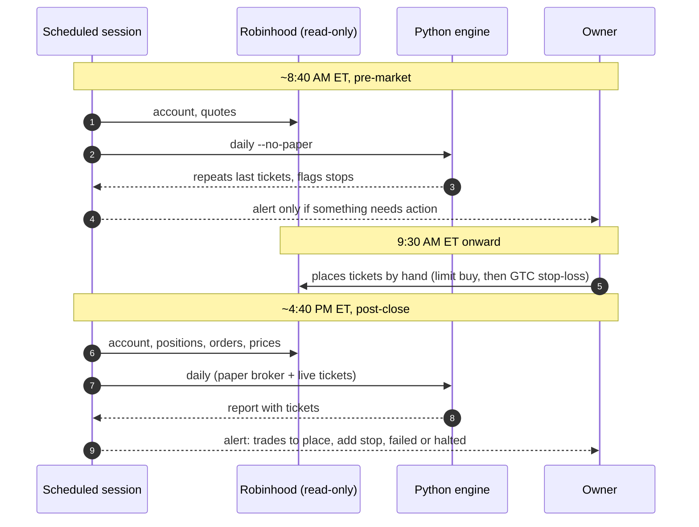

# agent-code

An AI-assisted trading **research, paper-trading and live-ticket** system for US
stocks and ETFs. It runs from scheduled Claude Code sessions with the Robinhood
MCP (read-only) and other market data connectors.

> **The system never places orders.** Since 2026-10-12, strategies B and C
> write **order tickets** for the real Robinhood "Agent-trading" account
> ($1,000 cap), and the owner places each one by hand in the Robinhood app. The
> code cannot place, modify or cancel brokerage orders, move money, use margin,
> sell short, or trade options or crypto. The config loader refuses to start
> if any of that is enabled, and a test fails if any broker order call appears
> in the source. Nothing here is investment advice.

## Architecture

### System overview



### From signal to ticket (post-close run)



### A day in the system



## What it does

Three independent strategies share one risk engine, one simulated paper broker,
and one daily report:

| Strategy | What it does | Evidence so far (backtests, costs included) |
|---|---|---|
| **A: S&P 500 scanner** (`strategies/scanner.py`) · *paper only* | Scans every current S&P 500 constituent (list refreshed from SPY's holdings filing). Ranks them by price strength, volume, quality, valuation and low volatility. Up to 3 that pass every filter become paper entries | ❌ On point-in-time S&P 500 lists (2019–2025, price factors only) it did **not** beat SPY. The score had no significant predictive power (rank IC ≈ 0). A factor ablation shows the full composite adds nothing over plain 12-1 momentum, at twice the turnover (no variant has \|t\| > 2). Research only |
| **B: focused desk** (`strategies/desk.py`) · *paper + live tickets* | Daily BUY / SELL / HOLD / WAIT / NO TRADE for **TQQQ, SQQQ, IBIT** (Bitcoin ETF) and **NVDA**, each with its own rules | ⚠️ Trading-only edge near zero per instrument; weak combined evidence (validation Sharpe 95% CI 0.11–2.17) |
| **C: GTAA** (`strategies/gtaa.py`) · *paper + live tickets* | Faber multi-asset trend: hold SPY, EFA, IEF, DBC, VNQ, TLT and GLD each while it trades above its 10-month average; rebalance at month-end | ✅ Validation (2019–2023, total return incl. dividends) +6.8%/yr, Sharpe 0.96, −6.9% max drawdown, vs SPY +11.1% with −34%. Train (2008–2019) only +3.6%/yr (Sharpe 0.53) vs SPY +10.5%. Modest returns, small losses; survives 3× costs |

Backtests are evidence with limits, not proof. Past performance does not
guarantee future results.

### Strategy B rules (pre-registered)

| Instrument | Entry | Exit / limits |
|---|---|---|
| TQQQ | QQQ close > 50-day SMA > 200-day SMA, QQQ above its 20-day SMA, QQQ 20-day volatility ≤ 25% | QQQ closes below its 20-day SMA, stop, or **5-day maximum hold**; **$2.50 max risk** |
| SQQQ | QQQ close < 50-day SMA < 200-day SMA, QQQ below its 20-day SMA, volatility ≤ 30% | Mirror image; same 5-day and $2.50 limits; **never held together with TQQQ** |
| Both leveraged ETFs | No entry within 1 day of a high-impact US release (CPI, FOMC, jobs…) or a Nasdaq-leader earnings date, measured from the fill day. A missing calendar also blocks entries | |
| NVDA | Close > 20-day SMA > 50-day SMA, 63-day momentum > 0, RSI < 75, relative strength vs SMH ≥ 0, no earnings within 5 days (an unknown date blocks entries) | Close below the 50-day SMA, or the stop |
| IBIT | Same trend rules (tracks spot bitcoin; trades only in US hours; spot BTC itself is not used) | Close below the 50-day SMA, or the stop |

## Risk limits (enforced in code, all strategies)

| Limit | Value on $1,000 paper equity |
|---|---|
| Max planned loss per position | 0.5% ($5); TQQQ/SQQQ 0.25% ($2.50) |
| Max aggregate planned open risk | 1.5% ($15) |
| Correlated positions (≥ 0.8 correlation) | Share one 1% ($10) budget |
| Max position size | 25% ($250), never more than cash (no margin) |
| Stops | 2.5 × ATR(14); sizing assumes the stop fills 20% worse (gaps) |
| Daily loss limit | 1% ($10): no new entries for the rest of the day |
| Drawdown shutdown | 5% ($50) from peak: no new entries; the **kill switch engages** until the owner releases it |
| **Real account only** (order gate, `account_limits`) | $100 per order; $200 and 3 new entries per day; $800 max exposure; $200 cash reserve; settled cash only; no leveraged or inverse ETFs (TQQQ/SQQQ are paper-only); fresh reconciled snapshot from the ticket day |
| Kill switch | `kill-switch status|engage|release`; persists across restarts; only the owner releases it |
| Costs | 10 bps slippage + 5 bps half-spread per side |

A stop price never guarantees the loss limit: gaps can fill worse.

With $5 per trade and a $15 total, **at most about 3 positions are open at
once**, typically $100–250 each, so much of the $1,000 stays in cash. That is
deliberate: the limits cap losses, and they also cap gains.

## Live tickets (real account)

| Setting (`live:` in `config/settings.yaml`) | Value |
|---|---|
| Account | Robinhood "Agent-trading" (••8204) only; snapshot must be under 24 hours old |
| Capital used for sizing | At most $1,000, whatever the account holds |
| Strategies | B (desk) and C (GTAA). A stays paper-only |
| Order type | Day limit order at the last close ± 0.5%; after a buy fills, a GTC stop-loss sell at the ticket's stop |
| Blocks | No new buys while any buy order is open, after a loss limit, or with an unverified snapshot |
| Positions opened by hand | Stop unknown, so their whole value counts as risk (blocks new buys) |
| Checks each run | Previous tickets (filled / still open / not placed); positions without a stop-loss order |
| Alerts | One phone alert only for: trades to place, a missing stop, a failed run, or a halt |

GTAA tickets appear only on the last trading day of a month. Desk tickets
appear only when its rules fire, so most days have no tickets.

## How it runs

The Python code cannot call MCP tools, so each run is a **Claude Code session**
that collects data with read-only MCP tools, saves it as JSON, imports it, and
runs the analysis ([docs/DAILY_ROUTINE.md](docs/DAILY_ROUTINE.md)):

| When (weekdays, US Eastern) | Run | What it does |
|---|---|---|
| 08:30 | Pre-market | Account snapshot, economic calendar, news, quotes → pre-market report; repeats the last live tickets |
| 12:30 | Midday check | Quotes and news; flags stop breaches and changed decisions (no paper trades) |
| 16:30 | Post-close | Prices, constituents, fundamentals, calendar, account → paper fills, stops, loss limits, new paper orders, **live tickets**, full report |
| Fri 17:30 | Weekly review | Local files only: paper P&L per strategy vs SPY, loss-limit headroom, missed runs |

These are Claude Code scheduled tasks (times have a few minutes of jitter).
They run only while the laptop is on and the Claude app is open; if it's
closed, a run happens the next time it opens. A missed post-close run means no
tickets that day, which is safe.

The daily report (`reports\daily_two_strategy_<date>_<label>.md`) has these sections:
- **A: Scanner.** Market regime, coverage (scanned vs expected constituents), top 10, actionable setups with entry, stop, target and evidence, and rejections.
- **B: Desk.** One section per instrument: signal, reasons, live quote, sizing, catalysts.
- **C: GTAA.** The current signals.
- **C (account):** Broker snapshot, live sizing, live loss limits and positions, paper positions, risk status.
- **D: Actions.** Research findings, paper actions, the status of the previous live tickets, and the **live order tickets** to place by hand.

## Data sources

| Data | Source | Notes |
|---|---|---|
| Account, positions, orders | Robinhood MCP (read-only, Agent-trading account) | Stored masked (last 4 digits only), rejected if over 24 hours old |
| Daily price history | Robinhood MCP `get_equity_historicals` | Split-adjusted. Never use `adjustment_type: all` for daily bars |
| Fundamentals, earnings dates | Robinhood MCP `preview_scan` (bulk, by market-cap band) | Current only, not point-in-time |
| Live quotes, spreads | Robinhood MCP `get_equity_quotes` | |
| S&P 500 constituents | Financial Datasets `get_index_fund` (SPY holdings) | Point-in-time lists from 2019. **Prepaid; balance currently exhausted** |
| News, SEC filings | Financial Datasets (headlines are unverified); Bigdata.com fallback | |
| Economic calendar | Bigdata.com | Drives the leveraged-ETF event blackout |
| T-bill rate, daily backup prices | Alpha Vantage (free key in `.env`) | 25 requests/day |

## Quick start (Windows)

Needs Python 3.12 (`winget install Python.Python.3.12`).

```powershell
python -m venv .venv
.\.venv\Scripts\python.exe -m pip install -e ".[dev]"
copy .env.example .env                     # add your free Alpha Vantage key (never commit .env)
.\.venv\Scripts\python.exe -m pytest       # all tests must pass
```

## Commands

```powershell
$py = ".\.venv\Scripts\python.exe"
& $py -m agent_trading daily [--no-paper] [--label premarket|intraday|postclose]   # full cycle + report
& $py -m agent_trading paper status                 # paper positions, P&L, pending orders
& $py -m agent_trading account show                 # last read-only broker snapshot

# Data imports (files saved from MCP tools by a Claude session)
& $py -m agent_trading universe import|import-history|show|symbols
& $py -m agent_trading snapshot fundamentals|quotes|news|filings|econ <files>
& $py -m agent_trading import-robinhood <get_equity_historicals JSON files>
& $py -m agent_trading account import <snapshot.json>
& $py -m agent_trading dividends <SYMBOL> <file>    # for GTAA total-return backtests
& $py -m agent_trading fetch [--symbols ...]        # Alpha Vantage fallback: prices, earnings calendar, T-bills

# Evidence
& $py -m agent_trading evaluate-scanner             # Strategy A: point-in-time lists + factor ablation
& $py -m agent_trading evaluate-desk                # Strategy B: 1x/2x/3x costs + baselines
& $py -m agent_trading evaluate-gtaa                # Strategy C: C0/C1/C2, total return
& $py -m agent_trading tournament [--no-test]       # all candidates vs benchmarks -> research/registry.jsonl
& $py -m agent_trading kill-switch status|engage|release
```

Every evaluation reports train and validation periods only. The most recent 20%
of history is an untouched holdout that no command evaluates.

## Project layout

```
config/settings.yaml          all limits, costs, strategy and data settings
src/agent_trading/
  strategies/                 scanner.py (A), desk.py (B), gtaa.py (C)
  risk.py                     RiskEngine, loss limits, order checks
  paper.py                    simulated broker (next-open fills, stops, time exits)
  live.py                     live order tickets for the real account (never sends orders)
  daily.py                    daily cycle + report
  data/                       validation, cache, universe, snapshots, rates, imports
  backtest/                   desk engine, allocation engine (GTAA), scanner backtest, splits, stats
  account.py, journal.py, regime.py, cli.py
docs/DAILY_ROUTINE.md         the runbook the scheduled Claude sessions follow
tests/                        unit, integration (mocked services) and safety tests
```

## Strategy tournament (2026-10-12)

`tournament` runs 12 pre-registered candidates (4 benchmarks, 8 strategies) through one engine:
- same data, costs, train/validation/test periods and metrics;
- walk-forward, cost stress, deflated Sharpe;
- an append-only registry in `research/`.

**Result: no candidate passed the acceptance rules.** GTAA (Strategy C) remains the lowest-drawdown option but trails SPY. Details:
- [research/TOURNAMENT_2026-10-12.md](research/TOURNAMENT_2026-10-12.md);
- [docs/FINAL_REPORT_2026-10-12.md](docs/FINAL_REPORT_2026-10-12.md).

## Known limitations

- **Survivorship bias:** about 10% of historical S&P 500 members are missing from the scanner backtest, either because the filing omits the ticker or because the stock is delisted on Robinhood. No point-in-time lists are available after Sept 2023.
- **Fundamentals:** current values only, so they can't be backtested.
- **Dividends:** the GTAA backtest uses total return (dividend-adjusted), but the daily GTAA signals and the other backtests use price-only bars.
- **Daily bars only:** intraday stop fills, partial fills, halts and taxes are not modelled, and exchange holidays aren't in code (the runbook checks them).
- **News:** headlines are unverified until the article is read.

## Roadmap

1. Paper trade all three strategies, giving the most weight to GTAA.
2. Compare paper results with the backtests.
3. **Live phase (started 2026-10-12, at the owner's request, before step 2 had evidence):** strategies B and C produce manual order tickets for the real Agent-trading account, sized on at most $1,000 with the same risk limits and loss stops (`live:` in `config/settings.yaml`, `src/agent_trading/live.py`). The code never sends orders; the owner places each ticket in the Robinhood app. Strategy A stays paper-only. The paper simulator keeps running alongside as the comparison.

## For AI assistants

See [CLAUDE.md](CLAUDE.md) for the rules any AI agent working in this repository must follow.
