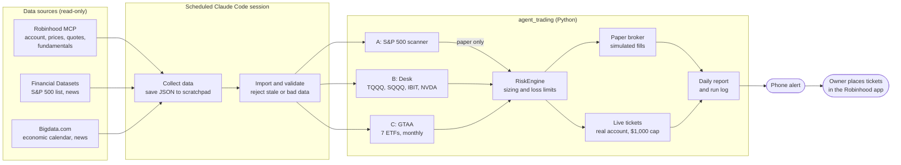
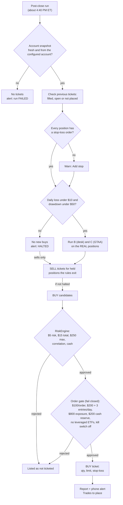
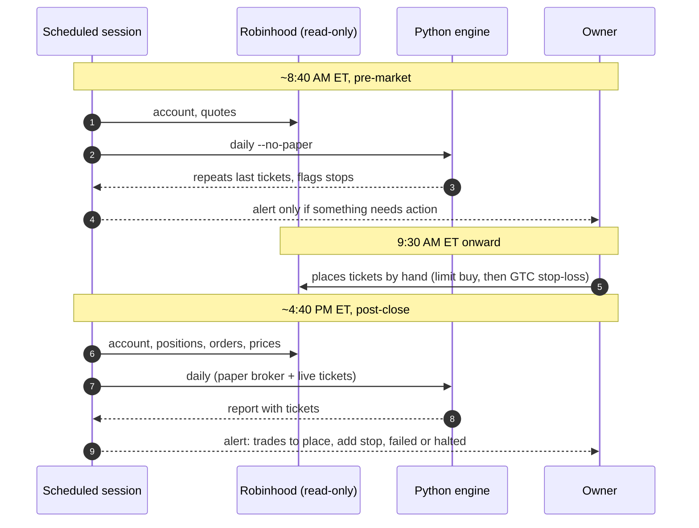

# Architecture and detailed rules

Detail moved out of [README.md](../README.md) on 2026-10-13. The README keeps the summary; this page keeps the diagrams and full tables.

## Diagrams

### System overview

### From signal to ticket (post-close run)

### A day in the system

### Strategy B rules (pre-registered)

| Instrument | Entry | Exit / limits |
|---|---|---|
| TQQQ | QQQ close > 50-day SMA > 200-day SMA, QQQ above its 20-day SMA, QQQ 20-day volatility ≤ 25% | QQQ closes below its 20-day SMA, stop, or **5-day maximum hold**; **$2.50 max risk** |
| SQQQ | QQQ close < 50-day SMA < 200-day SMA, QQQ below its 20-day SMA, volatility ≤ 30% | Mirror image; same 5-day and $2.50 limits; **never held together with TQQQ** |
| Both leveraged ETFs | No entry within 1 day of a high-impact US release (CPI, FOMC, jobs…) or a Nasdaq-leader earnings date, measured from the fill day. A missing calendar also blocks entries | |
| NVDA | Close > 20-day SMA > 50-day SMA, 63-day momentum > 0, RSI < 75, relative strength vs SMH ≥ 0, no earnings within 5 days (an unknown date blocks entries) | Close below the 50-day SMA, or the stop |
| IBIT | Same trend rules (tracks spot bitcoin; trades only in US hours; spot BTC itself is not used) | Close below the 50-day SMA, or the stop |

## Live tickets (real account)

| Setting (`live:` in `config/settings.yaml`) | Value |
|---|---|
| Account | Robinhood "Agent-trading" (the configured account) only; snapshot must be under 24 hours old |
| Capital used for sizing | At most $1,000, whatever the account holds |
| Strategies | B (desk) and C (GTAA). A stays paper-only |
| Order type | Day limit order at the last close ± 0.5%; after a buy fills, a GTC stop-loss sell at the ticket's stop |
| Blocks | No new buys while any buy order is open, after a loss limit, or with an unverified snapshot |
| Positions opened by hand | Stop unknown, so their whole value counts as risk (blocks new buys) |
| Checks each run | Previous tickets (filled / still open / not placed); positions not fully covered by open stop sell orders (limit sells don't count) |
| Same-day reruns | Earlier tickets for the day are kept and count against the daily limits; a symbol is never ticketed twice in a day |
| Alerts | One phone alert only for: trades to place, a missing stop, a failed run, or a halt |

GTAA tickets appear only on the last trading day of a month. Desk tickets
appear only when its rules fire, so most days have no tickets.

## Daily report sections

The daily report (`reports\daily_two_strategy_<date>_<label>.md`) has these sections:
- **A: Scanner.** Market regime, coverage (scanned vs expected constituents), top 10, actionable setups with entry, stop, target and evidence, and rejections.
- **B: Desk.** One section per instrument: signal, reasons, live quote, sizing, catalysts.
- **C: GTAA.** The current signals.
- **C (account):** Broker snapshot, live sizing, live loss limits and positions, paper positions, risk status.
- **D: Actions.** Research findings, paper actions, the status of the previous live tickets, and the **live order tickets** to place by hand.

## Data sources

| Data | Source | Notes |
|---|---|---|
| Account, positions, orders | Robinhood MCP (read-only, Agent-trading account) | Stored masked (last 4 digits only), rejected if over 24 hours old |
| Daily price history | Robinhood MCP `get_equity_historicals` | Split-adjusted. Never use `adjustment_type: all` for daily bars |
| Fundamentals, earnings dates | Robinhood MCP `preview_scan` (bulk, by market-cap band) | Current only, not point-in-time |
| Live quotes, spreads | Robinhood MCP `get_equity_quotes` | |
| S&P 500 constituents | Financial Datasets `get_index_fund` (SPY holdings) | Point-in-time lists from 2019. **Prepaid; balance currently exhausted** |
| News, SEC filings | Financial Datasets (headlines are unverified); Bigdata.com fallback | |
| Economic calendar | Bigdata.com | Drives the leveraged-ETF event blackout |
| T-bill rate, daily backup prices | Alpha Vantage (free key in `.env`) | 25 requests/day |

## Known limitations

- **Survivorship bias:** about 10% of historical S&P 500 members are missing from the scanner backtest, either because the filing omits the ticker or because the stock is delisted on Robinhood. No point-in-time lists are available after Sept 2023.
- **Fundamentals:** current values only, so they can't be backtested.
- **Dividends:** the GTAA backtest uses total return (dividend-adjusted), but the daily GTAA signals and the other backtests use price-only bars.
- **Daily bars only:** intraday stop fills, partial fills, halts and taxes are not modelled. `market_calendar.py` models regular NYSE holidays and recorded exceptional closures; it is not a live exchange-status feed. Price-cache staleness remains conservatively measured in weekdays.
- **News:** headlines are unverified until the article is read.

