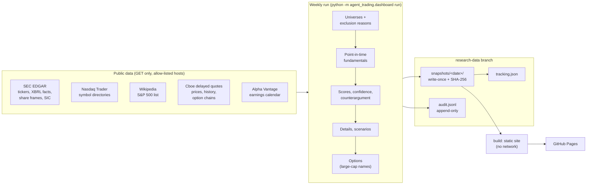

# Tikasa Stock Research Dashboard (GitHub Pages)

A static website, rebuilt every weekend by GitHub Actions, that compares US growth stocks, long-horizon speculative candidates, S&P 500 call and put contracts, and the owner's watchlist using rules fixed in advance. The outputs are **research comparisons only**: they are not personalized advice, recommendations, or instructions to trade. The dashboard never reads the brokerage account and never places orders.

- Code: `src/agent_trading/dashboard/`
- Workflow: `.github/workflows/research-dashboard.yml`
- Rules: `src/agent_trading/dashboard/spec.py` (pre-registered and hashed)
- Tests: `tests/test_dashboard.py`, `tests/test_dashboard_v2.py`, `tests/test_dashboard_http.py`, `tests/test_dashboard_site.py` (builds a two-snapshot demo site and checks it: links, page size, table labels, one h1 per page, no raw values), `tests/test_dashboard_ai.py` (AI lists, scenario test, private-company validation, page weight)
- Site modules: `site.py` (shell, detail pages, history, methodology, audit, build), `site_overview.py`, `site_lists.py`, `site_scan.py`, `site_ai.py`, `site_options.py`, `site_watchlist.py`, `fmt.py`; AI logic in `ai.py`

## What the site shows

| Page | Contents |
|---|---|
| Overview (`index.html`) | Daily review: snapshot summary, stored SPY/IJH/IWM market context, links to the two research pages, then changes, earnings, concentration/downside flags, performance vs benchmarks and data coverage. AI and options summaries and time-horizon guidance expand below. |
| Growth Stocks (`growth.html`) | Search, filters and device-local pins across the growth lists. Large-, mid- and small-cap shortcuts open each full table with financial trends, evidence, thesis, bear case, assumptions, invalidation and CSV downloads. The large-cap universe is S&P 500 members only. Multibagger candidates are kept on their own page. |
| Multibaggers (`multibaggers.html`) | Up to 5 speculative candidates with a 5–10 year research horizon: growth evidence, cash/runway, debt/dilution/valuation risk, conditional bear/base/bull scenarios, what must happen and what would invalidate the thesis. Pins are shared across research pages. Older snapshots explain when this list is unavailable. |
| Compare (`compare.html`) | Pick 2-4 companies (ranked names and watchlist operating companies) and see growth, margins and cash flow, valuation, debt and dilution, returns and drawdowns with their exact windows, score components and evidence quality side by side. A banner flags anything that does not line up (TTM windows ending more than 45 days apart, different scoring profiles or benchmarks, watchlist names that are not scored), and each missing cell says why. Price paths are rebased to 100 on the dates every selected name shares, never interpolated. Every column links to its SEC sources. Selection is kept in the URL hash, e.g. `compare.html#MU,FIX` |
| Stock detail (one per candidate) | **What changed since the previous snapshot** (new filings with EDGAR links, deterioration, dilution, thesis-condition breaches, data-availability changes, or why no comparison is possible); a **company research panel** (observed quarterly trends, supporting and counter-evidence, two earnings-quality checks, assumptions, verified/scheduled/estimated events, the thesis conditions recorded when the name first appeared with their current status, missing information, sources and dates); an **evidence-quality** check (passed checks, warnings, next checks); then price, market cap, sector, sources, timestamps; earnings dates (next: scheduled, unverified; last results: verified from SEC 8-K item 2.02 when found); thesis and strongest bear case; component inputs; price vs benchmark chart and 1m-5y return table; drawdowns; fundamentals (8 quarters) and valuation; bear/base/bull values at 1, 3 and 5 years with every assumption; a **scenario calculator** (your own starting growth, exit EV/Sales, dilution and FCF margin through the published formula, with a reset to the published assumptions; nothing is stored or published); risks; invalidation conditions; "probability not established" |
| AI stocks (`ai.html`) | Spec 2026-10-14.7. Top 5 AI-exposed large-cap and top 5 mid-cap stocks (same fixed scoring as the growth lists, from a curated AI universe with each company's role in the AI chain); a **top-20 market-cap scenario test** against today's 20th-largest S&P 500 market cap (conditional, never a probability, which the page states is not established); the universe by role with the reason any name was not ranked; and **private AI companies** (OpenAI, Anthropic, Databricks, Mistral...) for context, with reported valuations shown only with a dated source link and an "unverified" label |
| Options (`options.html`) | **Options watchlist**: a Calls/Puts control x 3M/6M/1Y tabs, six independently ranked lists of **up to 5** contracts each (spec 2026-10-14.6; 10 before), at most 2 per underlying, on the week's large-cap candidates only. The page is always linked and opens with a plain-language status (not collected / collection failed / stale / partial / available) and the owner setup step when collection is off. Each list shows how many qualified, why it is short, and why other contracts were left out. A compact row shows the underlying, contract symbol, expiry date and days remaining, strike, premium (ask x 100), breakeven with the required move, **maximum loss (visible on phones)**, spread, volume, open interest, IV, delta, theta, earnings status (scheduled / none scheduled / **unknown** when the calendar was not collected), the research score with its three parts, and the probability verdict. Expanding a row separates **observed facts** (delayed quote, snapshot time in UTC, source, delay, the underlying's and the contract's own last trade), **assumptions** (ask premium, breakeven, implied move, no fees, model notes), **unknown or missing** items, the **research score**, plain-language liquidity / time-decay / volatility / event risks, exact payoffs at expiration (before fees), a labelled 30-day Black-Scholes estimate, and "Probability not established". The page names the snapshot's methodology version next to the renderer's. CSV per list |
| Watchlist 2030 | The owner's ticker list (imported 2026-10-14, not synchronised). Each symbol is verified (name, exchange, type, listing status), with the latest verified price and timestamp. Conditional year-end-2030 bear/base/bull PRICE scenarios (% change and annualized) come from a company, ETF or leveraged-ETF method, with expandable assumptions, catalysts, bear case, invalidation, sources, evidence quality and missing information. Also: a range chart, theme concentration, sorting, filters and CSV. Unresolved or unmodellable symbols stay visible as 'Scenario unavailable' with the reason |
| Symbol pages (`symbol/<TICKER>.html`) | Everything known about one symbol: list ranks, listed option contracts, its watchlist scenario (or what would unlock one), and its ranks in every stored snapshot. Reached from the header's 'Find a ticker' box, which works offline from an inline list |
| Excluded (`excluded-<list>.html`) | Every stock considered for a list but not shown, grouped by reason, with the failing value |
| History & tracking | Every weekly report, and the forward returns of each stored list (1, 3, 6 and 12 months) vs benchmarks, net of assumed friction, with turnover and drawdown |
| Methodology | Every rule from `spec.py`, rendered, with the version history |
| Audit trail | **Data status**: one state per dataset (available, partial, stale, missing, provider error) with source, coverage and retrieval time; never a sample fallback. Then snapshot hashes ("local build" when no commit), integrity check, request counts, data-source notes, links to `data/latest.json`, `data/<as-of>.json` and `data/schema.json` (field descriptions), and the append-only event log |
| Feed | `feed.xml`: a static Atom feed of the weekly reports. The workflow sends nothing |

### Reading and using the site

- **Daily review desk:** the overview opens with a snapshot summary and SPY, IJH and IWM context, then the research briefing.
  Growth Stocks and Multibaggers have separate navigation tabs and dedicated pages. These are still **weekly snapshots**, not live quotes or a daily collection schedule.
  Benchmark 1Y price returns are reused from matching stored return windows; conflicting or unavailable values
  stay unavailable. Candidate counts are unique tickers, while the table keeps each ticker's list membership.
- **Growth candidate filters:** combine ticker/company/risk search, research list, sector, evidence level and missing
  inputs. Scores remain comparable within their original list only; the scanner does not rank across lists.
  Star a ticker to pin it on the current device, then select Pinned tickers. Pins also appear on Multibaggers and Watchlist 2030.
  Browser storage failures leave pins usable for that page and display an explanation. `/` focuses the scanner
  search; Reset filters clears the current view. Filters never change stored research or published rankings.
- **Existing bookmarks:** `index.html#large`, `#mid`, `#small`, `#growth` and `#candidate-scan` follow the
  growth page; `index.html#multibagger` follows the multibagger page. List and exclusion backlinks use the new routes.
- **Watchlist scan:** symbol/price/scenario counts lead the page; scenario availability and pinned-ticker filters
  narrow the table. The full range chart and methods expand below it. Unavailable scenarios keep their reasons
  and all table cells, so sorting remains aligned. Missing numerical values sort last in either direction.
- **Further product work:** prioritize a separately stored daily market snapshot (with suitable source rights and
  freshness checks), restore the earnings calendar, then add timestamped snapshot-to-snapshot change alerts and
  saved comparison views. Keep the immutable weekly research series separate from any faster market feed.
  The first scan release changes presentation only: no scores, gates, scenario assumptions or research rules change.

- **Time frames** are kept separate: trailing returns, conditional scenarios, option expiry windows and tracking periods.
- **Weekly changes:** "What changed since the previous snapshot?" lists filings, deterioration, dilution, thesis breaches
  and data-availability changes for names on both snapshots, and explains each rank move by the change in the 0-100
  score and the component scores that moved most.
- **Freshness** is counted in completed NYSE sessions in New York time ("the latest completed session", "2 trading
  sessions old"); a warning appears after six sessions.
- **Evidence badges** look the same on every page: the evidence level, the source's own label and the number of missing
  inputs.
- **Options:** pages open on Calls / 3 months; a URL hash such as `#put-6m` selects another view, the hash follows
  each click, and in-page links to a hash switch the view. Tab lists work with the keyboard (Left/Right, Home/End).
  "Distance to breakeven" is signed, or reads "already past breakeven". The overview carries an **Options watchlist**
  block with the six lists in compact form (or the status when none can be shown).
- **Phone layout:** under 700px the lists keep rank, ticker, price, score, 1Y and main risk, and options keep rank,
  underlying, expiry, strike, premium, breakeven, **maximum loss** and score, plus the "can lose the entire premium"
  warning. Ticker columns stay pinned while tables scroll, and the navigation is one scrolling row.
- **Theme and print:** the theme button cycles auto, light and dark, and is remembered on the device. Printing hides
  controls and expands every section.
- **Long definitions** (multibagger, probabilities, scenario method) are one sentence plus a toggle on the overview and
  detail pages. The methodology page has the full text.

### Spec 2026-10-14.7: AI stocks page

Registered on 2026-10-14 before any snapshot was evaluated with it. The 2026-10-13 snapshot has no AI lists and stays
as published under 2026-10-14.3; its AI page explains that, and the first weekly snapshot collected under .7 adds them.
Nothing about the growth lists, scoring scales or weights, option rules or tracking rules changed.

- **Two new lists** (`ai_large`: market cap of $10B or more; `ai_mid`: $2B to $10B), up to **5 stocks each**, shown only
  on `ai.html` (not as growth tabs). Same standard scoring profile, scales, weights, liquidity floors, Robinhood
  tradability rule and benchmarks (SPY, IJH) as the growth lists; the only new rule is the universe.
- **The universe is a fixed, curated list** (`spec.AI_UNIVERSE`, about 60 US-listed common stocks in ten roles of the AI
  supply chain: chips, memory and storage, chip equipment, networking and optical, servers, cloud platforms, AI software
  and data, neoclouds and data centers, power and cooling, and a diversified group that includes a frontier AI lab). It
  is hashed with the rest of the spec, so adding or removing a name is a new methodology version. Membership is a
  recorded judgement, not a measurement. Foreign filers without US-GAAP XBRL (TSMC, ASML) cannot be scored. A name that
  cannot be evaluated (not listed, a new listing with little history, outside both cap bands, tradability unverified)
  keeps its reason on `excluded-ai_large.html` / `excluded-ai_mid.html`; unverified names go on the Robinhood
  to-check list like any other list.
- **Top-20 market-cap scenario test** (`dashboard/ai.py`). The bar is the 20th-largest market cap among the S&P 500
  members with valid data in the same run. For each listed AI stock the page shows the market cap implied by its bear,
  base and bull scenario at 5 and 10 years (value per share x scenario share count) as a multiple of that bar. The bar is
  held at today's level and will probably rise, so "above" means above today's bar, not "a top-20 company". It is a
  conditional comparison, never a probability.
- **No probabilities.** A probability that a company reaches the top 20 needs an out-of-sample calibration record
  (`PROBABILITY_GATE`); none exists, so the page says "Probability not established" and offers the scenario test instead.
- **Private AI companies** (`config/ai_private_companies.json`, context only). A valuation is accepted only with a
  currency, basis, date, source label and https source link, and is shown as reported and unverified, never as a market
  cap; the run degrades to a visible problem (status `partial`) instead of publishing a record without a source. A
  USD valuation is placed against today's largest S&P 500 market caps in words ("between #10 and #11"); other
  currencies are not converted. Companies without a corroborated valuation (reports conflict or are unconfirmed) are
  listed as "also watched" with the reason, with no number. Not ranked, scored or tradable, and no price. The file was
  reviewed on 2026-10-14 from press and law-firm reports; update it by editing the file with sources and re-running.
  When a private company lists, it joins the ranked lists only through a new methodology version.
- **Context at review time (reported, not verified):** SpaceX (SPCX, which reportedly absorbed xAI in February 2026) and
  Cerebras (CBRS) have listed and are in the universe; OpenAI and Anthropic are reported to have filed confidentially for
  IPOs with no listing date announced.

### Fixes on 2026-10-14 (improvement cycle; no methodology change, so no new spec version)

- **Lighter overview.** The evidence block of every listed stock is a small JSON file under `fragments/` fetched when its
  row first opens, instead of being inline: the overview of the 2026-10-13 snapshot goes from 222 KB to 131 KB of HTML
  (about 37 KB to 28 KB compressed on the wire). A failed fetch shows a link to the full research page and retries on
  the next open. Search covers the visible row text, not the unopened evidence. Printing includes only rows that were
  opened.
- **Sortable headers are real buttons**, with `aria-sort`, a visible arrow for the current order, and a polite
  screen-reader announcement ("Sorted by Score, descending.").
- **Saved views.** The last search, sector filter, filter selects (the candidate scanner's list, evidence, inputs and
  pinned choices) and sort of each table are remembered in this browser only (localStorage, per page and table, silently
  skipped when storage is blocked). A restored view is announced and the row count shows what is hidden. **Reset view**
  (or the scanner's own **Reset filters**, which now also restores the default order) clears it; pinned tickers are kept.
  Tabs are still never restored silently. The AI lists appear in the candidate scanner under their own list names, and
  the scanner, the watchlist and the other tables share one table script.

- **Tracking counts NYSE sessions.** `tracking.forward_return` decided "pending" or "prices stop (possible
  delisting)" by counting weekdays, which overstates elapsed sessions by one per exchange holiday. On the day a
  horizon fell due in a holiday week (for example 21 weekdays after 2026-01-02 is only 20 sessions, MLK Day), every
  complete series was reported as a possible delisting and the horizon as unavailable. Elapsed sessions now come from
  the same NYSE calendar as the tracking schedule shown on the site; a series that reaches the as-of session with
  fewer bars than sessions is reported as "missing bars", never bridged.
- **Point-in-time SEC filing dates.** The SEC submissions file is a current view. The "last results (8-K item 2.02)"
  date and the watchlist's next-filing estimate now ignore filings made after the as-of date, so a rerun for an
  earlier week, or a Saturday run after a holiday Friday (EDGAR is open on Good Friday), never shows a later release
  as verified.
- **A failed tracking update no longer loses the week.** The workflow commits the data branch only when the run exits
  0 or 2. A crash in the tracking step after the snapshot was written used to exit 1, which dropped the snapshot and
  the audit lines with it. The run now records `tracking_failed` in the audit log, writes a `partial` status and
  exits 0; `tracking.json` is recomputed from the stored snapshots on the next run.
- **Accessibility.** Every column header carries `scope="col"` (including the browser-built comparison table), the
  growth and options tab lists follow the ARIA tabs pattern (each tab names the panels it controls and each panel
  names its tabs), and every page starts with a "Skip to content" link to a focusable `main` landmark.

### Spec 2026-10-14.6: options watchlist, correctness fixes, probability gate

Registered on 2026-10-14 before any snapshot was evaluated with it (the only published snapshot, 2026-10-13, has no
option data and stays as published under 2026-10-14.3).
- **Six lists of up to 5** (`OPTION_RULES["max_per_type_per_horizon"]`, was 10). Windows (70-110, 150-210, 300-430
  days), liquidity, spread, delta, standard-contract and per-underlying rules and the ranking weights are unchanged.
  Older snapshots render with the limit they were built under (`spec.option_list_limit`), and every options page
  names the snapshot's methodology version next to the renderer version.
- **Theta** (`OPTION_THETA_RULE`): a contract whose theta is missing or exactly zero is not eligible, with the reason
  "theta unavailable". Before this version a missing theta became zero and earned the maximum time-decay score.
  `theta_share_per_day` stays null when theta is missing; `rank_components.time_decay_missing` records it.
- **Quote freshness** (`OPTION_QUOTE_RULE`): the chain's own snapshot timestamp (Cboe reports it in UTC; converted to
  the New York date) must not predate the as-of session, in addition to the underlying's last trade. A contract's
  own `last_trade_time` says when it last traded, not when it was quoted; it is stored as `contract_last_trade` and
  shown separately. `quote_time_utc`, `quote_date_ny` and `quote_status` are stored per contract and per underlying.
- **Earnings status** (`OPTION_EVENT_RULE`): `events_status` is `scheduled`, `none scheduled` or `unknown`; it is
  `unknown` whenever the calendar lookup failed or was not configured, so the page never shows "none scheduled" for
  missing data. Older snapshots without the field fall back to the stored unavailability note.
- **Fees** (`FEE_TREATMENT`): no commissions or fees are deducted; every payoff, breakeven and maximum-loss figure
  says so. Pre-expiration figures are labelled Black-Scholes model estimates with their assumptions.
- **Probability of profit** (`dashboard/probability.py`): defined as the probability that net P/L is positive at
  expiration after the stated premium and costs, distinct from finishing in the money. A percentage can be displayed
  only for a `CalibrationRecord` that passes `PROBABILITY_GATE` (required fields, at least 200 resolved contracts per
  option type and horizon, at least a year of expirations, calibration error at most 0.05, out-of-sample forecasts,
  no reuse of the consumed 2022+ holdout, an uncertainty interval). The registry holds no record, so every contract
  shows **"Probability not established — insufficient validated evidence."** Delta, the research score, scenario
  weights and pricing-model outputs never enter the probability path (a test checks the engine passes no estimate).
  `DATA_CONTRACT` lists what must be recorded per listed contract before a calibration can exist, and
  `PROBABILITY_MISSING_DATA` what is missing today (no stored historical chains, no expired listed contracts, no
  forecasts recorded before outcomes, no evaluation period yet, no broker-matched fees).
- **Display:** the options page is always in the menu and explains its state; the overview has an Options watchlist
  block; scenario-test flags (2x in 5 years, 5x in 5 years, 5x in 10 years, 2x in 10 years) are shown separately
  from passing the research screen; tab lists are keyboard-operable.

### Spec 2026-10-14.5: data quality, research panel, comparisons (display rules only)

Registered before any snapshot was evaluated with it. No ranking rule, scale, weight, gate or list size changed.
- **Data states** (`dashboard/evidence.py`): every dataset gets one state, derived from the stored snapshot, so older
  snapshots get the same treatment. A failed or unconfigured earnings lookup is "missing" or "provider error", never
  "no earnings scheduled".
- **Return windows:** each trailing return stores its start and end session. List sparklines use the 1-year window and
  the return table's own figures. Older snapshots showed a weekly-sampled line about 260 sessions long next to a
  252-session table return (MU: +470% vs +425%).
- **Watchlist prices** are verified on their own. A fund with too little history keeps its verified price and its
  exposure-class scenario; only the analyses needing more history are unavailable, and each one says how many bars exist.
- **Research panel** (`dashboard/research.py`), **what changed** (`dashboard/changes.py`), **comparison**
  (`dashboard/compare.py`) and **scenario calculator** (`dashboard/lab.py`; tested to reproduce the published base case
  exactly) are deterministic. No text is generated.
- **Attribution:** some structures are adapted from filingcopilot (MIT), ticker-dossier (MIT) and cc-equity-research
  (Apache-2.0). See [THIRD_PARTY_NOTICES.md](../THIRD_PARTY_NOTICES.md) for files, pinned commits and licenses.
- **Assets** are linked with a content hash (`style.css?v=...`), so a browser never pairs new pages with a cached old
  stylesheet or script.

## Architecture



- **`http.py`** is the only module that touches the network. It sends GET requests only, to allow-listed HTTPS hosts. It spaces requests per host, retries timeouts, 429s and 5xx errors at most 3 times with backoff, and fails fast on other errors. It enforces a request budget per provider and caches responses on disk. Query strings (API keys) never reach logs or cache file names.
- **`providers.py`**: pure parsers plus thin fetchers. Every failure becomes a `FetchError`, and the pipeline turns that into a visible exclusion reason.
- **`fundamentals.py`** reuses the quarter-derivation logic from the 2026-10-12 S&P 500 growth screen. Only XBRL facts **filed on or before the as-of date** are used (no look-ahead).
- **`scoring.py`, `scenarios.py`, `options.py`** apply the rules in `spec.py` mechanically.
- **`store.py`** handles storage:
  - snapshots are written once with a manifest hash and are never overwritten;
  - a rerun for the same week keeps the original;
  - the audit log is append-only;
  - a snapshot containing account-like fields (account number, positions, cash, API keys...) is refused.
- **`site.py`** renders HTML, CSS, JS and CSV from stored snapshots without network access. The build refuses to publish if any secret value appears in the output.
- Reused from the repo: `market_calendar` (NYSE holidays), `data.validation` (stale, split and frozen-feed checks), the Alpha Vantage earnings parser, and secret redaction from `logging_setup`.

## Data providers: what was checked and why

Live checks were run from a local machine on 2026-10-13; GitHub-hosted runners were not tested.

| Provider | Coverage | Terms / licence | Rate limits | History | Runs in CI? | Decision |
|---|---|---|---|---|---|---|
| **SEC EDGAR** (data.sec.gov, sec.gov) | All US-GAAP 10-K/10-Q filers: XBRL facts, cover-page shares, ticker-CIK-exchange map, SIC | US government public data | Fair access: ≤ 10 requests/s with a declared User-Agent containing a real contact. **Verified: SEC returns 403 for a `users.noreply.github.com` address** | XBRL from about 2009; filing dates make it point-in-time | No key needed. Verified locally | **Fundamentals, shares, universe** |
| **Nasdaq Trader** symbol directories | Every Nasdaq, NYSE, NYSE American, NYSE Arca and Cboe BZX listing, with ETF, test-issue and Nasdaq financial-status flags | Public files | 2 files per run | Current only | Verified locally | **Listing exchange, common-stock filter** |
| **Wikipedia** "List of S&P 500 companies" | Current members, GICS sector, CIK | CC BY-SA 4.0: attribution given in the footer; open to edits, so the parser enforces 480-520 rows | 1 request | Current only. Membership history starts with the stored weekly snapshots | Verified locally | **S&P 500 membership.** Financial Datasets (prepaid balance exhausted) and FMP (constituents denied on the current plan) were unavailable |
| **Cboe delayed quotes** (cdn-api.cboe.com) | Stock quotes; daily OHLCV since 2004, split-adjusted, **not dividend-adjusted**; full option chains with bid/ask, IV, delta/gamma/theta/vega/rho, OI, volume | **Undocumented public JSON behind cboe.com.** Cboe's website terms allow personal, non-commercial use; republishing needs Cboe's written consent. See owner actions | Unpublished. **HTTP 429 observed at 4 requests/s**; the client starts at 2/s and slows itself on each 429 (down to one request every 3 s), honouring `Retry-After` | Daily bars since 2004; no historical option chains | No key needed. Verified locally. Cloudflare could block GitHub runner IPs (unverified) | **Prices and option chains, publication gated by the owner** |
| **Alpha Vantage** (free key) | `EARNINGS_CALENDAR` (all symbols, 12 months, 1 request) | Free tier | 25 requests/day | Not used for history | Key as a GitHub secret. Verified locally | **Earnings dates** (optional) |
| Robinhood MCP | Quotes, Greeks, fundamentals | Account-linked | n/a | n/a | **No:** needs an interactive, logged-in Claude session and touches the brokerage context | Not used |
| Stooq | Daily prices | Now requires a key obtained through a CAPTCHA; requests without it return a bot check (verified) | Daily quota | Long | Unsuitable | Not used |
| Massive (formerly Polygon) free tier | All US stocks, EOD | Individual, non-redistributable | 5 requests/min | 2 years on the free tier | Possible | Not used: 2-year history is too short for 5-year returns; Greeks need a paid plan |
| Tiingo free tier | EOD prices | Personal use | About 500 unique symbols/month (third-party figures) | Long | Possible | Not used: too few symbols for the broad universe |
| FMP (current plan), Financial Datasets, Bigdata.com | Various | Paid/prepaid | Plan-limited | | | Not used: access denied, balance exhausted, or MCP-only |

**Licensing bottom line:**
- SEC, Nasdaq Trader and Wikipedia data can be published with attribution.
- Cboe's quotes and option chains are the open question. Cboe's site terms allow personal, non-commercial use, and a GitHub Pages site is public.
- The publish step is therefore off until you set `DASHBOARD_PUBLISH=true`.

## Definitions (from `spec.py`)

Spec version **2026-10-14.6** (current) is the options watchlist, correctness and probability-gate version (see
"Spec 2026-10-14.6" above). Spec version 2026-10-14.5 added display and data-quality rules only.

Spec version 2026-10-14.4 fixes a data gap the owner approved on 2026-10-14, after the first live snapshot (2026-10-13):
- companies tag a fiscal fourth quarter's diluted share count only as a full-year figure;
- so dilution (the one-year change in diluted shares) was missing whenever the latest quarter was a fiscal Q4 (MU, STX and WDC in October 2026). That scored the input 0 and failed the multibagger dilution gate;
- dilution now compares the newest quarter that has a quarterly count with the same quarter a year earlier, at most one quarter back (`DILUTION_LOOKBACK_QUARTERS`);
- nothing else changed, and the 2026-10-13 snapshot stays as published under 2026-10-14.3.

Spec version 2026-10-14.3 added a free-cash-flow margin cross-check to the watchlist's company scenarios.

Spec version 2026-10-14.2 is the owner's redesign. It was written down and committed before any data was evaluated with it:
- three growth lists of up to 10: large cap (S&P 500 members), mid cap ($2B-$10B) and a new small cap ($300M-$2B);
  - the small-cap list takes the old speculative list's $2 price and $2M liquidity floors, without its 20% growth gate;
  - old snapshots keep their `spec` list, shown as retired;
- the long-horizon list is renamed **Speculative multibagger research candidates** and shows up to 5;
- options cover **calls and puts**, up to 10 per type per horizon, with the same windows, filters and per-underlying limit;
  - put |delta| must be between 0.30 and 0.70;
  - put breakeven = strike - premium;
  - premium = the delayed ask x 100;
- a separate **watchlist** with conditional 2030 price scenarios.

Scoring scales and weights are unchanged.

Spec version 2026-10-14.1 applied two earlier owner requests:
- only stocks verified as tradable on Robinhood are published;
- a new long-horizon multibagger list was added.

- **Robinhood tradability (all lists):** a stock is published only if Robinhood's read-only
  `get_equity_tradability` check, at most 35 days old, reports:
  - `tradeable` true;
  - state active;
  - tradable for an individual account in regular hours.

  Anything else excludes the stock with the reason: not tradable, not found, unverified or stale. Scores use
  fixed scales, so removing a stock never reorders the others.
- **Long-horizon multibagger list (5-10 years):** S&P 500 and broad universe together, $500M-$50B.
  - **Gates, all required (a missing input fails):**
    - TTM and 3-year revenue growth ≥ 15%;
    - gross margin ≥ 35%;
    - ≥ 12 reported quarters;
    - dilution ≤ 8% a year;
    - survival: positive FCF, or ≥ 2 years of cash runway.
  - **Score weights (long-horizon profile):** growth durability 30%, earnings/FCF 10%, quality 15%, balance
    sheet 15%, valuation 15%, runway + operating leverage 10% (new component), momentum 5%.
  - **Scenarios:** 1, 3, 5 and 10 years. Flags show whether the bull case reaches 5x and the base case 2x
    within ten years.
  - **Rationale:** in `spec.MULTIBAGGER_RATIONALE`. Most stocks that pass will not become multibaggers, and
    no probability is shown.
- **Large cap:** current S&P 500 members.
- **Mid cap:** $2B to $10B.
- **Speculative:** $300M to $2B with at least 20% trailing revenue growth.
- **Market cap:** as-of close x SEC cover-page shares outstanding, with a flagged diluted-share fallback.
- **Broad universe:** common stocks and ordinary shares on NYSE, Nasdaq, NYSE American, NYSE Arca and Cboe BZX that are SEC registrants.
  - Excluded: OTC securities, ETFs, warrants, rights, units, preferreds, notes, ADRs, SPACs, bankrupt issuers, and foreign filers without US-GAAP XBRL.
  - One share class per company (the most liquid).
- **Liquidity:** a minimum price and 20-day median dollar volume per category.
- **Limited history:** fewer than 8 reported quarters, or fewer than about 2 years of prices. Flagged, and confidence is reduced.
- **Multibagger:** a bull-case value ≥ 5x today's price in five years. A 2x result is shown separately as "doubling". All scenario values are conditional, never targets or maxima.
- **Probabilities:** none are shown, because no model here has out-of-sample calibration. Option delta is explicitly *not* a probability of profit.
- **Option horizons:** 70-110, 150-210 and 300-430 days to expiration.
- **Option eligibility:**
  - OI ≥ 500, volume ≥ 10, spread ≤ 10% of mid, |delta| 0.30-0.70;
  - implied volatility and theta present (a missing or zero theta is "theta unavailable", never zero decay);
  - standard 100-share contracts only;
  - at most 2 contracts per underlying, up to 5 per list (10 before 2026-10-14.6);
  - the underlying must have traded in the as-of session and the chain's snapshot must not predate it.
- **Option ranking:** 45% liquidity, 35% breakeven vs implied move, 20% time decay. Upside is not an input, and a
  highly ranked put is not a view that the underlying will fall.
- **Probability of profit:** never shown without a calibration record that passes `PROBABILITY_GATE`; today every
  contract reads "Probability not established — insufficient validated evidence."

**Changing a rule:** add a new `SPEC_VERSION` with a `SPEC_CHANGELOG` entry. Snapshots carry the spec hash, and tracking keeps versions apart. Version 2026-10-13.2 added "one share class per company" after the 25-stock smoke test listed GOOG and GOOGL separately. That is a data-integrity fix; no score, scale or weight changed.

## Schedule, time zones and failures

- **When:** Saturday 14:17 UTC, with a Sunday 14:17 UTC retry. GitHub cron runs in UTC and ignores daylight saving time.
  - That is 10:17 EDT or 09:17 EST: well after Friday's close, and after Cboe's daily history files catch up. They were observed to lag the close by several hours.
  - The Sunday run does nothing if Saturday's snapshot exists.
  - **Run workflow** (manual dispatch) accepts an as-of date and an options on/off switch.
- **Holidays:** the as-of date is the latest completed NYSE session (`market_calendar`), for example Thursday after Good Friday. A non-trading as-of date is refused.
- **Unavailable closing data:** each stock needs a bar for the as-of session.
  - If the history file lags, the end-of-session quote supplies that bar, and the stock is flagged.
  - A stock with neither is excluded as stale.
  - If fewer than 90% of S&P 500 members have a valid as-of price, or a benchmark is missing, the run **fails** instead of publishing a partial ranking.
- **API budgets:** per-provider request caps (SEC 4,000; Cboe 7,000; Alpha Vantage 3). When a budget is spent, the remaining items are marked "not evaluated: request budget spent" and the run status becomes `partial`.
- **Retries:** at most 3 attempts per request, and only for timeouts, connection errors and 5xx.
  - HTTP 429 gets up to 5 attempts, honours `Retry-After`, and slows that provider for the rest of the run.
  - Requests that still fail are listed per stock, and the run is marked `partial`.
- **Overlap:** a workflow `concurrency` group serializes runs, without cancelling a run in progress.
- **Failures:**
  - A failed run writes `status.json` and an audit entry, and keeps every earlier snapshot.
  - A failure after the snapshot is written (the tracking update) is recorded as `tracking_failed`; the snapshot is
    kept, the status is `partial`, and tracking is recomputed on the next run.
  - The site is rebuilt from the last good snapshot, with a red "latest weekly update failed" banner.
  - The final workflow job fails, so the run shows red in the Actions tab.
  - If no new build is deployed at all, the page's own script shows a "may be out of date" banner once the data is over nine days old.
- **Notifications:** the workflow sends no messages. GitHub may email you about failed runs under your own notification settings.
- **Expected cost** (full-scale local run on 2026-10-13): see the "Full-scale verification" section below. Private-repository Actions minutes count against your plan.

## Validation and performance tracking

- Each weekly snapshot is immutable (SHA-256 manifest); `verify` re-checks all of them on every run.
- Tracking compounds each snapshot's equal-weighted list from its as-of close over 21, 63, 126 and 252 sessions
  (NYSE sessions, counted with the same calendar as the schedule shown on the history page).
  - Results are **price returns, minus assumed friction** (15, 25 and 50 bps per side for large, mid and speculative), compared with SPY, IJH or IWM.
  - Turnover and a one-week chained drawdown are also reported.
- **Bias controls:**
  - only prices after a snapshot judge it;
  - lists are never reselected after the fact;
  - fundamentals are point-in-time;
  - names whose prices stop are reported as "possible delisting", not dropped. Delisting returns are not available from these sources.
- No edge is claimed before 52 snapshots, and none afterwards without a statistical test. Nothing is tuned on tracked results; a rule change creates a new spec version.

## Watchlist — 2030 Outlook

- **Source:** `config/research_watchlist.json` holds tickers only, plus the import date and its source note. Edit the
  file to change the list; it never syncs automatically. No account details, quantities, cost basis or balances
  are allowed, and the loader rejects such fields.
- **Separate universe:** a watchlist symbol is never added to, or used to rank, the growth lists.
- **Verification (every run):**
  - names, exchanges, ETF flags and listing status come from the Nasdaq Trader directories and the SEC ticker file;
  - a symbol found in neither is shown as unresolved, with no substitute;
  - OTC symbols are shown as not exchange-listed.
- **Horizon:** the actual time from the as-of close to 2030-12-31, not a rolling 5 years.
- **Methods:**
  - **Companies:** revenue x EV/Sales to 2030 under the growth lists' bear/base/bull rules, plus net cash, divided by
    diluted shares. Unavailable without positive revenue, positive EV and at least 4 reported quarters.
    - **Margin link** (spec 2026-10-14.3): each scenario also carries an FCF-margin path to 2030. It starts from
      today's TTM FCF margin, or the operating margin, and moves -5, 0 or +5 points by 2030. That gives 2030 FCF
      and the implied EV/FCF multiple.
    - A value with negative 2030 FCF, or above 60x EV/FCF, is flagged as not supported by cash generation. The
      price itself is unchanged.
  - **Unleveraged ETFs:** exposure-class total-return assumptions, minus an assumed fee and an assumed distribution
    yield, give a price return. The class comes from the fund name, using the keyword table in `spec.py`. With no
    class the scenario is unavailable. Company formulas are never applied to funds.
  - **Leveraged ETFs:** g = L·mu - L²·sigma²/2 - (L-1)·financing - fee.
    - Sigma is the tracked index fund's trailing 3-year volatility (x1.25 in the bear case, x0.85 in the bull case).
    - It is never L x the index return.
    - Inverse funds, or funds whose index can't be identified, show "Scenario unavailable".
- **Labels:** "Conditional 2030 price scenarios". These are price returns only, on the split-adjusted price basis.
  The base case is not "most likely", and no probabilities are shown.
- **Fund fees and yields** are assumptions by class and are flagged as unverified: no permitted CI source provides
  them.

## Robinhood tradability checks (Claude session, read-only)

GitHub Actions cannot reach the Robinhood MCP, so verdicts are stored on the `research-data` branch in
`robinhood_tradability.json`, with symbols, verdicts, reasons and dates only and no account data. Each run
writes `robinhood_tradability_todo.json`: unverified names near or inside each list's cutoff. To refresh, in a
Claude session:

1. Run `git worktree add ..\agent-code-research-data research-data`, or update an existing worktree with
   `git pull`.
2. Run `python -m agent_trading.dashboard tradability todo --data ..\agent-code-research-data`. It prints
   the symbols 10 per line.
3. For each line, call the read-only Robinhood `get_equity_tradability` tool (Agent-trading account) and save
   the JSON `data` to the scratchpad.
4. Run `python -m agent_trading.dashboard tradability import --data ..\agent-code-research-data <files>`.
   Payloads containing account fields are rejected.
5. Commit and push `research-data`. The next weekly run uses the new verdicts.

If no verdicts are stored at all, the run fails visibly instead of publishing unverified stocks.

## Commands

```powershell
$py = ".\.venv\Scripts\python.exe"
$env:SEC_USER_AGENT = "agent-code research you@example.com"   # a real contact address; SEC rejects noreply domains
& $py -m agent_trading.dashboard run --data research-data --cache .cache\http [--as-of 2026-10-09] [--no-options] [--limit 25]
& $py -m agent_trading.dashboard build --data research-data --out site
& $py -m agent_trading.dashboard verify --data research-data
```

`--limit N` processes N stocks per universe (smoke test only; the S&P coverage check is skipped).

## Owner actions (required before the first deployment)

0. **Robinhood tradability verdicts:** run the refresh above at least monthly, or when the to-check list grows.
1. **Merge the pull request into `main`.** Scheduled workflows only run from the default branch.
2. **GitHub Pages and the private repository.**
   - On GitHub Free, Pages needs a public repository.
   - A private repository needs GitHub Pro, Team or Enterprise.
   - The published site is publicly reachable either way, unless you use Enterprise Cloud's private Pages.
   - Do not make this repository public: it contains the trading system.
   - Then go to Settings → Pages → Build and deployment → Source: **GitHub Actions**.
3. **Secrets** (Settings → Secrets and variables → Actions → Secrets):
   - `SEC_USER_AGENT` = a project name plus a real contact email (required);
   - `ALPHAVANTAGE_API_KEY` (optional, earnings dates).
4. **Data terms.**
   - Review Cboe's website terms for republishing delayed quotes and option chains on a public site.
   - Either obtain consent, accept the risk knowingly, or run with options disabled. Stock prices on the site also come from Cboe.
   - Then set the repository **variable** `DASHBOARD_PUBLISH` = `true`. Until then the workflow builds and checks the site but does not deploy it.
   - Option chains are **off** unless the repository variable `DASHBOARD_OPTIONS` = `true`. The owner chose stocks-only publication on 2026-10-14, because of Cboe's terms. While options are off, the Options page stays in the menu and explains that nothing was collected, with this setup step. Enabling it changes nothing for earlier snapshots; the six lists appear in the first weekly snapshot collected afterwards (a manual "Run workflow" with the options box ticked also works, and the data branch keeps the snapshot).
   - `ALPHAVANTAGE_API_KEY` is also needed for the contracts' earnings status; without it every contract reads "unknown" (never "none scheduled").
5. **First run:** Actions → research-dashboard → Run workflow. Check the run summary, the `research-data` branch and the site.
6. If branch protection rules cover all branches, allow `github-actions[bot]` to push `research-data`. The workflow never force-pushes.

## Known limitations

- Prices are delayed, end-of-session snapshots, never live. Returns exclude dividends.
- The Cboe endpoints are undocumented and can change without notice. When they break, runs fail visibly (stale banner); they do not show invented data.
- Cboe option rows give each contract's last trade time but no per-contract quote timestamp; the chain file's own snapshot timestamp (UTC) is the quote time for every contract in it, and the two are kept apart on the page. Chains are accepted only when the underlying traded in the as-of session and the snapshot does not predate it.
- No probability of profit can be calibrated yet: no historical option chains are stored, no listed contract has expired, and no forecast has been recorded before an outcome. The data contract for a future calibration is documented in `dashboard/probability.py`; nothing is back-filled.
- **Broad-universe gaps:**
  - Companies without a cover-page share count in recent SEC frames are excluded. This includes some multi-class issuers.
  - Foreign private issuers (20-F/40-F) cannot be scored.
- **Sectors:** S&P 500 sectors are GICS (Wikipedia). Others are mapped coarsely from SEC SIC codes.
- **Not scored:** competitive position, catalysts and customer concentration have no reliable structured source. They are listed as not scored.
- **Debt:** total debt can be overstated when a filer's `LongTermDebt` tag already includes the current portion (conservative).
- **Option events:** only scheduled earnings dates are checked, from Alpha Vantage, and they are labelled unverified because no verified calendar is reachable from CI. Ex-dividend dates and other corporate events before expiry are not.
- **Thesis and invalidation text:** these are template-generated from the numbers. They summarize evidence; they are not analyst judgement.
