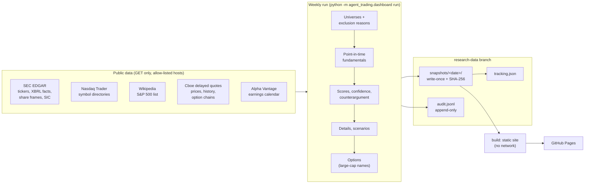

# Weekly research dashboard (GitHub Pages)

A static website, rebuilt every weekend by GitHub Actions, that compares US stocks and S&P 500 call options using rules fixed in advance. The outputs are **research comparisons only**: they are not personalized advice, recommendations, or instructions to trade. The dashboard never reads the brokerage account and never places orders.

- Code: `src/agent_trading/dashboard/`
- Workflow: `.github/workflows/research-dashboard.yml`
- Rules: `src/agent_trading/dashboard/spec.py` (pre-registered and hashed)
- Tests: `tests/test_dashboard.py`, `tests/test_dashboard_http.py`

## What the site shows

| Page | Contents |
|---|---|
| Overview | Data-freshness and stale-data banners, the weekly summary, and three category tabs. Each tab has a searchable, sortable, sector-filtered table with component scores, confidence and the strongest counterargument. Each tab also shows rank changes with explanations, concentration warnings, the next ten names, every excluded stock with its reason, and a CSV download |
| Stock detail (one per candidate) | Price, market cap, sector, sources, timestamps; thesis and strongest bear case; component inputs; price vs benchmark chart and 1m-5y return table; drawdowns; fundamentals (8 quarters) and valuation; bear/base/bull values at 1, 3 and 5 years with every assumption; risks; invalidation conditions; "probability not established" |
| Options research | 3-, 6- and 12-month horizons. Up to five liquid call contracts per horizon, with bid/ask, spread, volume/OI, IV, Greeks, premium x 100, adjusted-contract flag, breakeven, maximum loss, payoffs at expiration, a 30-day Black-Scholes sensitivity grid, and earnings before expiry. Shows an unavailable state when no valid chain exists |
| History & tracking | Every weekly report, and the forward returns of each stored list (1, 3, 6 and 12 months) vs benchmarks, net of assumed friction, with turnover and drawdown |
| Methodology | Every rule from `spec.py`, rendered, with the version history |
| Audit trail | Snapshot hashes, integrity check, request counts, data-source notes, and the append-only event log |

## Architecture



- **`http.py`** is the only module that touches the network. It sends GET requests only, to allow-listed HTTPS hosts. It spaces requests per host, retries timeouts, 429s and 5xx errors at most 3 times with backoff, and fails fast on other errors. It enforces a request budget per provider and caches responses on disk. Query strings (API keys) never reach logs or cache file names.
- **`providers.py`**: pure parsers plus thin fetchers. Every failure becomes a `FetchError`, and the pipeline turns that into a visible exclusion reason.
- **`fundamentals.py`** reuses the quarter-derivation logic from the 2026-10-12 S&P 500 growth screen. Only XBRL facts **filed on or before the as-of date** are used (no look-ahead).
- **`scoring.py`, `scenarios.py`, `options.py`** apply the rules in `spec.py` mechanically.
- **`store.py`** handles storage:
  - snapshots are written once with a manifest hash and are never overwritten;
  - a rerun for the same week keeps the original;
  - the audit log is append-only;
  - a snapshot containing account-like fields (account number, positions, cash, API keys...) is refused.
- **`site.py`** renders HTML, CSS, JS and CSV from stored snapshots without network access. The build refuses to publish if any secret value appears in the output.
- Reused from the repo: `market_calendar` (NYSE holidays), `data.validation` (stale, split and frozen-feed checks), the Alpha Vantage earnings parser, and secret redaction from `logging_setup`.

## Data providers: what was checked and why

Live checks were run from a local machine on 2026-10-13; GitHub-hosted runners were not tested.

| Provider | Coverage | Terms / licence | Rate limits | History | Runs in CI? | Decision |
|---|---|---|---|---|---|---|
| **SEC EDGAR** (data.sec.gov, sec.gov) | All US-GAAP 10-K/10-Q filers: XBRL facts, cover-page shares, ticker-CIK-exchange map, SIC | US government public data | Fair access: ≤ 10 requests/s with a declared User-Agent containing a real contact. **Verified: SEC returns 403 for a `users.noreply.github.com` address** | XBRL from about 2009; filing dates make it point-in-time | No key needed. Verified locally | **Fundamentals, shares, universe** |
| **Nasdaq Trader** symbol directories | Every Nasdaq, NYSE, NYSE American, NYSE Arca and Cboe BZX listing, with ETF, test-issue and Nasdaq financial-status flags | Public files | 2 files per run | Current only | Verified locally | **Listing exchange, common-stock filter** |
| **Wikipedia** "List of S&P 500 companies" | Current members, GICS sector, CIK | CC BY-SA 4.0: attribution given in the footer; open to edits, so the parser enforces 480-520 rows | 1 request | Current only. Membership history starts with the stored weekly snapshots | Verified locally | **S&P 500 membership.** Financial Datasets (prepaid balance exhausted) and FMP (constituents denied on the current plan) were unavailable |
| **Cboe delayed quotes** (cdn-api.cboe.com) | Stock quotes; daily OHLCV since 2004, split-adjusted, **not dividend-adjusted**; full option chains with bid/ask, IV, delta/gamma/theta/vega/rho, OI, volume | **Undocumented public JSON behind cboe.com.** Cboe's website terms allow personal, non-commercial use; republishing needs Cboe's written consent. See owner actions | Unpublished. **HTTP 429 observed at 4 requests/s**; the client starts at 2/s and slows itself on each 429 (down to one request every 3 s), honouring `Retry-After` | Daily bars since 2004; no historical option chains | No key needed. Verified locally. Cloudflare could block GitHub runner IPs (unverified) | **Prices and option chains, publication gated by the owner** |
| **Alpha Vantage** (free key) | `EARNINGS_CALENDAR` (all symbols, 12 months, 1 request) | Free tier | 25 requests/day | Not used for history | Key as a GitHub secret. Verified locally | **Earnings dates** (optional) |
| Robinhood MCP | Quotes, Greeks, fundamentals | Account-linked | n/a | n/a | **No:** needs an interactive, logged-in Claude session and touches the brokerage context | Not used |
| Stooq | Daily prices | Now requires a key obtained through a CAPTCHA; requests without it return a bot check (verified) | Daily quota | Long | Unsuitable | Not used |
| Massive (formerly Polygon) free tier | All US stocks, EOD | Individual, non-redistributable | 5 requests/min | 2 years on the free tier | Possible | Not used: 2-year history is too short for 5-year returns; Greeks need a paid plan |
| Tiingo free tier | EOD prices | Personal use | About 500 unique symbols/month (third-party figures) | Long | Possible | Not used: too few symbols for the broad universe |
| FMP (current plan), Financial Datasets, Bigdata.com | Various | Paid/prepaid | Plan-limited | | | Not used: access denied, balance exhausted, or MCP-only |

**Licensing bottom line:**
- SEC, Nasdaq Trader and Wikipedia data can be published with attribution.
- Cboe's quotes and option chains are the open question. Cboe's site terms allow personal, non-commercial use, and a GitHub Pages site is public.
- The publish step is therefore off until you set `DASHBOARD_PUBLISH=true`.

## Definitions (from `spec.py`)

- **Large cap:** current S&P 500 members.
- **Mid cap:** $2B to $10B.
- **Speculative:** $300M to $2B with at least 20% trailing revenue growth.
- **Market cap:** as-of close x SEC cover-page shares outstanding, with a flagged diluted-share fallback.
- **Broad universe:** common stocks and ordinary shares on NYSE, Nasdaq, NYSE American, NYSE Arca and Cboe BZX that are SEC registrants.
  - Excluded: OTC securities, ETFs, warrants, rights, units, preferreds, notes, ADRs, SPACs, bankrupt issuers, and foreign filers without US-GAAP XBRL.
  - One share class per company (the most liquid).
- **Liquidity:** a minimum price and 20-day median dollar volume per category.
- **Limited history:** fewer than 8 reported quarters, or fewer than about 2 years of prices. Flagged, and confidence is reduced.
- **Multibagger:** a bull-case value ≥ 5x today's price in five years. A 2x result is shown separately as "doubling". All scenario values are conditional, never targets or maxima.
- **Probabilities:** none are shown, because no model here has out-of-sample calibration. Option delta is explicitly *not* a probability of profit.
- **Option horizons:** 70-110, 150-210 and 300-430 days to expiration.
- **Option eligibility:**
  - OI ≥ 500, volume ≥ 10, spread ≤ 10% of mid, delta 0.30-0.70;
  - standard 100-share contracts only;
  - at most 2 contracts per underlying.
- **Option ranking:** 45% liquidity, 35% breakeven vs implied move, 20% time decay. Upside is not an input.

**Changing a rule:** add a new `SPEC_VERSION` with a `SPEC_CHANGELOG` entry. Snapshots carry the spec hash, and tracking keeps versions apart. Version 2026-10-13.2 added "one share class per company" after the 25-stock smoke test listed GOOG and GOOGL separately. That is a data-integrity fix; no score, scale or weight changed.

## Schedule, time zones and failures

- **When:** Saturday 14:17 UTC, with a Sunday 14:17 UTC retry. GitHub cron runs in UTC and ignores daylight saving time.
  - That is 10:17 EDT or 09:17 EST: well after Friday's close, and after Cboe's daily history files catch up. They were observed to lag the close by several hours.
  - The Sunday run does nothing if Saturday's snapshot exists.
  - **Run workflow** (manual dispatch) accepts an as-of date and an options on/off switch.
- **Holidays:** the as-of date is the latest completed NYSE session (`market_calendar`), for example Thursday after Good Friday. A non-trading as-of date is refused.
- **Unavailable closing data:** each stock needs a bar for the as-of session.
  - If the history file lags, the end-of-session quote supplies that bar, and the stock is flagged.
  - A stock with neither is excluded as stale.
  - If fewer than 90% of S&P 500 members have a valid as-of price, or a benchmark is missing, the run **fails** instead of publishing a partial ranking.
- **API budgets:** per-provider request caps (SEC 4,000; Cboe 7,000; Alpha Vantage 3). When a budget is spent, the remaining items are marked "not evaluated: request budget spent" and the run status becomes `partial`.
- **Retries:** at most 3 attempts per request, and only for timeouts, connection errors and 5xx.
  - HTTP 429 gets up to 5 attempts, honours `Retry-After`, and slows that provider for the rest of the run.
  - Requests that still fail are listed per stock, and the run is marked `partial`.
- **Overlap:** a workflow `concurrency` group serializes runs, without cancelling a run in progress.
- **Failures:**
  - A failed run writes `status.json` and an audit entry, and keeps every earlier snapshot.
  - The site is rebuilt from the last good snapshot, with a red "latest weekly update failed" banner.
  - The final workflow job fails, so the run shows red in the Actions tab.
  - If no new build is deployed at all, the page's own script shows a "may be out of date" banner once the data is over nine days old.
- **Notifications:** the workflow sends no messages. GitHub may email you about failed runs under your own notification settings.
- **Expected cost** (full-scale local run on 2026-10-13): see the "Full-scale verification" section below. Private-repository Actions minutes count against your plan.

## Validation and performance tracking

- Each weekly snapshot is immutable (SHA-256 manifest); `verify` re-checks all of them on every run.
- Tracking compounds each snapshot's equal-weighted list from its as-of close over 21, 63, 126 and 252 sessions.
  - Results are **price returns, minus assumed friction** (15, 25 and 50 bps per side for large, mid and speculative), compared with SPY, IJH or IWM.
  - Turnover and a one-week chained drawdown are also reported.
- **Bias controls:**
  - only prices after a snapshot judge it;
  - lists are never reselected after the fact;
  - fundamentals are point-in-time;
  - names whose prices stop are reported as "possible delisting", not dropped. Delisting returns are not available from these sources.
- No edge is claimed before 52 snapshots, and none afterwards without a statistical test. Nothing is tuned on tracked results; a rule change creates a new spec version.

## Commands

```powershell
$py = ".\.venv\Scripts\python.exe"
$env:SEC_USER_AGENT = "agent-code research you@example.com"   # a real contact address; SEC rejects noreply domains
& $py -m agent_trading.dashboard run --data research-data --cache .cache\http [--as-of 2026-10-09] [--no-options] [--limit 25]
& $py -m agent_trading.dashboard build --data research-data --out site
& $py -m agent_trading.dashboard verify --data research-data
```

`--limit N` processes N stocks per universe (smoke test only; the S&P coverage check is skipped).

## Owner actions (required before the first deployment)

1. **Merge the pull request into `main`.** Scheduled workflows only run from the default branch.
2. **GitHub Pages and the private repository.**
   - On GitHub Free, Pages needs a public repository.
   - A private repository needs GitHub Pro, Team or Enterprise.
   - The published site is publicly reachable either way, unless you use Enterprise Cloud's private Pages.
   - Do not make this repository public: it contains the trading system.
   - Then go to Settings → Pages → Build and deployment → Source: **GitHub Actions**.
3. **Secrets** (Settings → Secrets and variables → Actions → Secrets):
   - `SEC_USER_AGENT` = a project name plus a real contact email (required);
   - `ALPHAVANTAGE_API_KEY` (optional, earnings dates).
4. **Data terms.**
   - Review Cboe's website terms for republishing delayed quotes and option chains on a public site.
   - Either obtain consent, accept the risk knowingly, or run with options disabled. Stock prices on the site also come from Cboe.
   - Then set the repository **variable** `DASHBOARD_PUBLISH` = `true`. Until then the workflow builds and checks the site but does not deploy it.
5. **First run:** Actions → research-dashboard → Run workflow. Check the run summary, the `research-data` branch and the site.
6. If branch protection rules cover all branches, allow `github-actions[bot]` to push `research-data`. The workflow never force-pushes.

## Known limitations

- Prices are delayed, end-of-session snapshots, never live. Returns exclude dividends.
- The Cboe endpoints are undocumented and can change without notice. When they break, runs fail visibly (stale banner); they do not show invented data.
- Cboe option rows give each contract's last trade time but no quote timestamp. Chains are accepted only when the underlying traded in the as-of session.
- **Broad-universe gaps:**
  - Companies without a cover-page share count in recent SEC frames are excluded. This includes some multi-class issuers.
  - Foreign private issuers (20-F/40-F) cannot be scored.
- **Sectors:** S&P 500 sectors are GICS (Wikipedia). Others are mapped coarsely from SEC SIC codes.
- **Not scored:** competitive position, catalysts and customer concentration have no reliable structured source. They are listed as not scored.
- **Debt:** total debt can be overstated when a filer's `LongTermDebt` tag already includes the current portion (conservative).
- **Option events:** only scheduled earnings dates are checked. Ex-dividend dates and other corporate events before expiry are not.
- **Thesis and invalidation text:** these are template-generated from the numbers. They summarize evidence; they are not analyst judgement.
