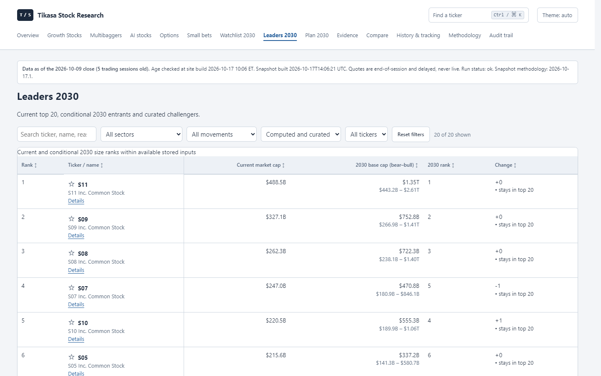
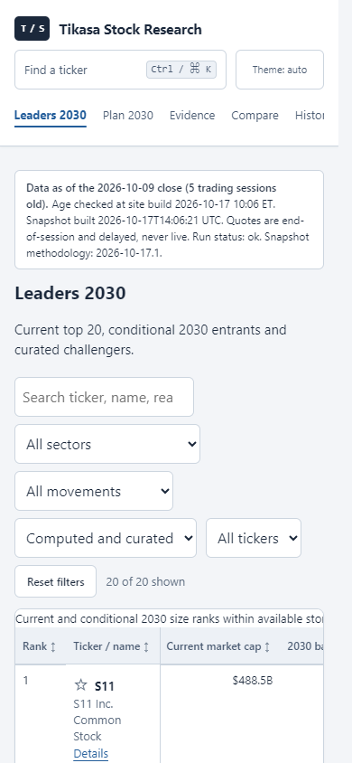

# Task 2: Leaders top 20

The weekly collector now completes public price and SEC fact inputs for every S&P 500 member, including members excluded by research-screen price/liquidity gates. It reuses successful and failed cache entries, the registered short-history fallback, request budgets, pacing and SEC user agent. No stored snapshots are changed.

The table selects the current top 20 plus conditional 2030 top-20 entrants and curated challengers. Its six columns keep current and conditional future caps together; each row links to its full evidence. Partial coverage states the actual denominator. Known current caps remain visible when a scenario is unavailable.

| Viewport | HTML bytes before → after | Words before data before → after | First-screen points before → after |
|---|---:|---:|---:|
| Desktop 1440 × 900 | 37,278 → 28,582 | 66 → 54 | 37 → 54 |
| Mobile 390 × 844 | 37,278 → 28,582 | 66 → 54 | 5 → 5 |

Measurements use the Task 0 definition. Both themes have the same counts and zero page errors, failed requests or horizontal overflow. [Raw measurements](leaders/metrics.json). The baseline is in the merged Task 0 PR (#46).

## Text inventory

- Share-count basis/date, dilution notes, price/cap dates, evidence grade, missing-input reasons and growth drivers moved from table cells to each row's linked Details page.
- Summary counts, snapshot/derived methodology versions, curated omissions and the full ranking/coverage explanation moved to the native “Coverage, assumptions and methodology” disclosure below the table.
- The introduction is one sentence. Top-50 labels now say top 20 under the new registration; all unavailable inputs remain disclosed.

## Validation and registration

Full local CI: 976 tests passed; Ruff lint/format and configured Mypy passed; 299 deterministic fixture files, zero differences; snapshot verification and 142-page links/size checks passed. Headless Chromium checked fixture (20 rows) and older public snapshot (10 rows): numeric sorting/reset, search/reset, pin filtering, row evidence links and no-JavaScript coverage disclosure. The public build has 159 pages with zero broken links or size violations.

SPEC_VERSION `2026-10-17.1`, hash `7878076b25e6eecd`, reason: “owner requested a top-20 view; full S&P 500 coverage”. Prior registrations and the freeze date are preserved. [Collection budget/runtime assessment and owner instructions](../../LEADERS_2030.md).

## Owner action

Review and merge the PR. For fresh coverage, run **Actions → research-dashboard → Run workflow**, branch `main`, leave `as_of` blank for the latest completed session and set `dry_run` false to publish. Keep the existing required variables and SEC_USER_AGENT secret configured. The existing public snapshot remains 10/503 until a successful new weekly collection; complete coverage is subject to provider availability and budgets.

Task 2b will separately register the requested scenario sanity changes. Tasks 3–4 cover the remaining site-wide layout and full browser matrix.
