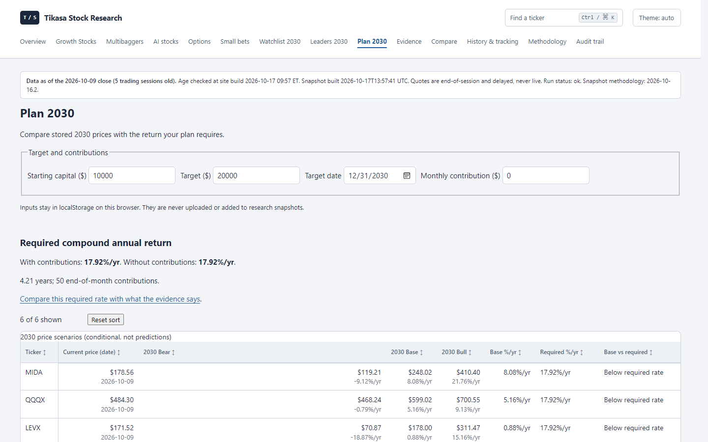
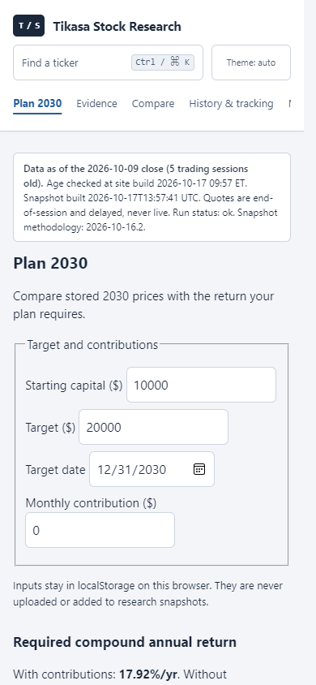

# Plan 2030 price table — Task 1

The table now reads the stored `price`, `price_date`, and
`scenarios[case].price` alongside each stored annualized rate. No valuation or
return is recomputed. A verified daily close is shown only when its session is
newer than the scenario's price date; it is excluded from all calculator inputs
and numeric sort values for the original price.

Rows with scenarios appear first. All eight columns sort using the existing
table controls; Reset sort restores the initial order. Missing rows show dashes
with the original reason in tooltips and one shortened reason. HTML and JSON
escape untrusted ticker, date and reason strings. Saved allocation IDs keep
their original ticker mapping despite the display reordering.

## Before and after

The same offline CI fixture and baseline measurement method were used.
Only Plan 2030 is changed in this task. Desktop is 1440 × 900; mobile is 390 × 844.

| Page / viewport | Bytes before → after | Words before data before → after | First-screen points before → after |
|---|---:|---:|---:|
| Plan / desktop | 21,492 → 27,461 | 118 → 78 | 2 → 32 |
| Plan / mobile | 21,492 → 27,461 | 118 → 78 | 0 → 1 |

[Full baseline and before screenshots](https://github.com/vsakati6691/agent-code/blob/ae39a92/docs/ux/2026-10-17/BASELINE.md)
and [raw after metrics](plan/metrics.json). Both themes have zero page errors,
failed requests and horizontal document overflow.

## Text moved

- Long introduction (plan start, snapshot date, constant annualized rate,
  exclusions and cash assumption) → “How this is calculated”.
- Contribution timing explanation → the same native disclosure.
- Original table-order and base-rate comparison explanation → the same
  disclosure, updated to explain scenario-first display order.
- Annualized-only caption and headings → requested dollar-price columns;
  every stored annualized rate remains visible as a sub-line.
- Repeated missing-scenario labels → one stored reason, dashes and tooltips.

All explanations remain one click away without JavaScript. No methodology
rules or scenario assumptions were removed.

## Validation

Full local CI: 973 tests passed; Ruff check/format and configured Mypy passed;
fixture determinism, snapshot verification, links and size budgets passed.
The registration guard passes with unchanged version `2026-10-16.2` and hash
`ed13539391c855db`. New tests cover stored prices, dated daily context,
missing values, escaping and stable allocation IDs.

Headless Chromium checks passed for numeric sorting/reset, calculator updates,
local saved weights across reload, reset inputs, and the server-rendered price
table and native disclosure with JavaScript disabled. Calculator math is
unchanged. Task 4 adds the complete cross-page browser regression matrix.

Owner action: review and merge this display-only PR. No weekly collection is
needed for stored Plan prices to appear. The site-wide layout pass follows in
Task 3; this task does not claim to finish the mobile data-first layout.
