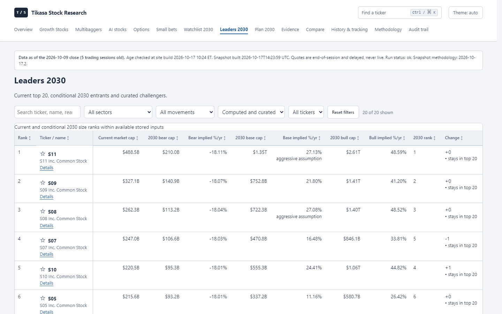
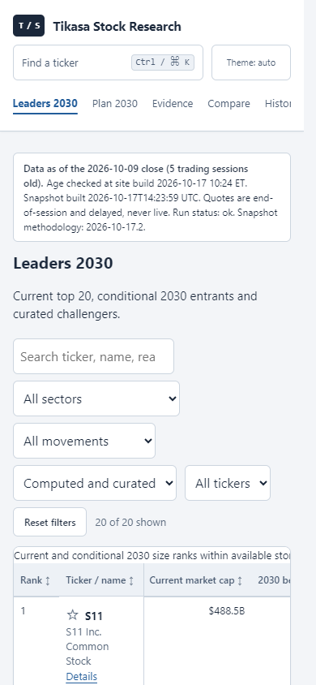
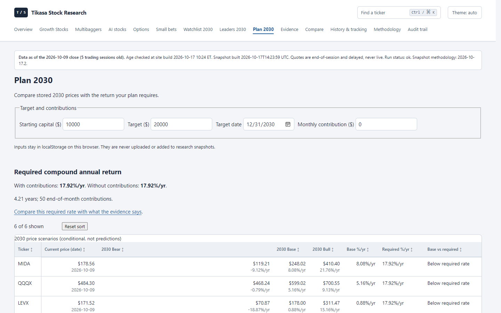
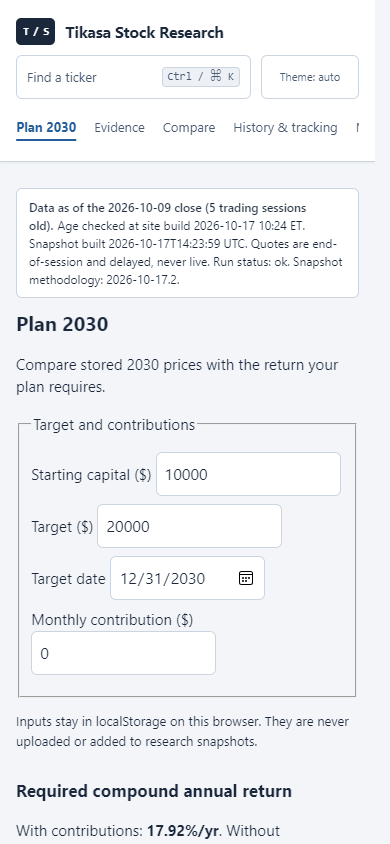

# Task 2b: Leaders scenario sanity

SPEC_VERSION **2026-10-17.2**, hash `48a72cddda547a92`, registers the owner's requested scenario sanity changes. Base uses three-year revenue CAGR, with a dated fiscal-year fallback and no one-year-growth fallback. Above $500B, annual fade doubles from 20% to 40%. Bear starts with declining revenue (-20% or lower for registered memory/storage/equipment names) and an explicitly disclosed cap ceiling of 90% of current. These are conditional stress assumptions, not fitted or calibrated outcomes.

Every bear/base/bull cap has its own adjacent implied %/yr column. Base cap CAGR above 25%/yr is flagged “aggressive assumption”. Each Details page exposes the growth basis/path, fade, valuation inputs, raw cap and bear stress reduction. Curated caps lacking current values have dashes for implied rates; missing inputs are not invented.

Plan 2030 now explains why company and SMH/QQQ scenarios diverge, displays stored ETF return/fee/distribution arithmetic, and distinguishes per-share price return from cap CAGR. It preserves stored Watchlist scenarios and calculator math. [Registered assumptions](../../LEADERS_2030.md).

| Page / viewport | HTML bytes baseline → after | Words above data baseline → after | First-screen points baseline → after |
|---|---:|---:|---:|
| Leaders desktop 1440 × 900 | 37,278 → 41,602 | 66 → 54 | 37 → 78 |
| Leaders mobile 390 × 844 | 37,278 → 41,602 | 66 → 54 | 5 → 5 |
| Plan desktop 1440 × 900 | 21,492 → 29,858 | 118 → 78 | 2 → 32 |
| Plan mobile 390 × 844 | 21,492 → 29,858 | 118 → 78 | 0 → 1 |

Relative to Tasks 1–2: Leaders grows from 28,582 bytes / 54 desktop points to 41,602 bytes / 78 points; Plan grows from 27,461 to 29,858 bytes with unchanged first-screen counts. Both themes/sizes have zero console/page errors, failed requests or page overflow. Tables scroll within their wrappers. [Raw measurements](scenario-sanity/metrics.json).

## Text inventory

- Combined “2030 base cap (bear–bull)” becomes three separate cap/rate pairs, as requested.
- The obsolete claim that Leaders uses unchanged Watchlist math is replaced with the registered Leaders method inside “Coverage, assumptions and methodology”. Prior wording remains in historical registrations.
- Growth/valuation assumptions and the raw-versus-stressed bear cap are on each row's existing Details page.
- Plan adds one native “Why company and ETF scenarios differ (SMH, QQQ)” disclosure; no calculator or stored assumptions are removed.
- CSV columns remain unchanged. Additional fields are in derived JSON and HTML evidence.

## Validation

Full local CI passed: **993 tests**, Ruff lint/format, configured Mypy, **299 deterministic fixture files with zero differences**, snapshot verification and **142 HTML pages with zero broken links or size violations**.

Focused model/Plan tests and historical registration/safety checks pass. Cases cover peak-TTM invariance, the strict $500B threshold, missing/future-dated CAGR, every registered cyclical name, negative/zero revenue growth, cash-rich/debt-heavy valuations, bear below current for every computed row, implied CAGR arithmetic/rendering, escaping and ETF explanation arithmetic. Existing snapshot immutability and ranking/tie/coverage tests remain green.

Chromium checks pass on the synthetic fixture (20 Leaders) and latest available public snapshot (2026-10-15, 10 Leaders): sorting/reset, search/reset, pins, linked Details and no-JavaScript disclosure. Plan calculator changes, stored weight mapping, reload/reset and no-JavaScript prices still pass. Public build: 159 pages, zero broken links or size failures. The snapshot remains unchanged; new collection is required for broader coverage.

The owner authorized merge/deployment and a latest-data workflow run during this task. Deployment and collection outcomes are reported in the chat after validation; no production action is represented as complete by this document.
